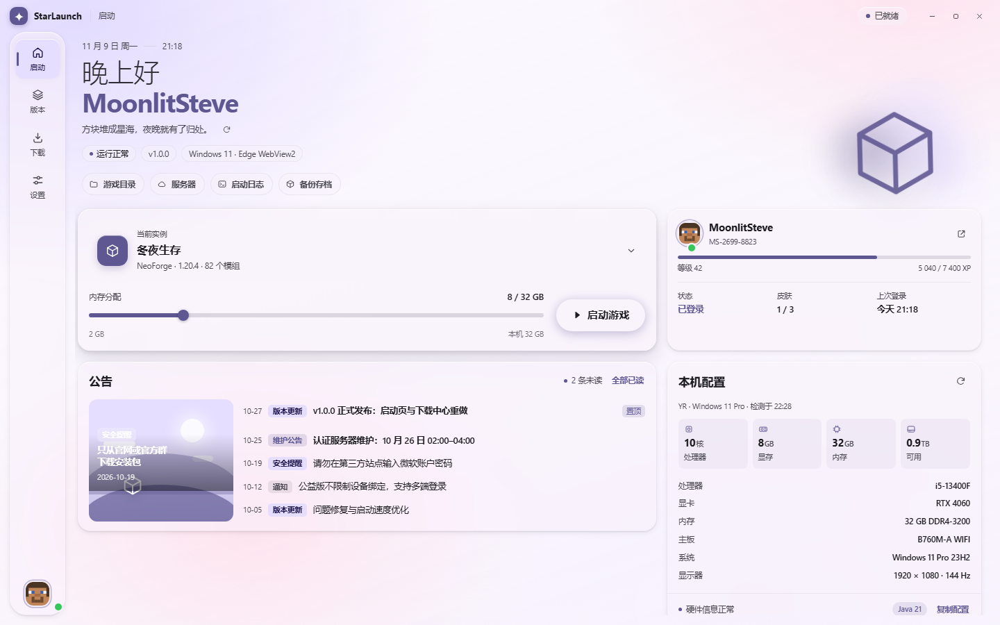

# StarLaunch

> 一个把界面交给 Web、把脏活留给 C# 的 Minecraft 启动器。
> 外壳只有一个无边框窗口和一块 WebView2；界面是零依赖的 HTML + CSS + 原生 JavaScript，
> Material You 配色在本机实时计算，全程不联网也能用。



## 目录

- [它是什么](#它是什么)
- [设计取向](#设计取向)
- [功能一览](#功能一览)
- [界面预览](#界面预览)
- [技术栈](#技术栈)
- [快速开始](#快速开始)
- [架构一览](#架构一览)
- [数据放在哪](#数据放在哪)
- [开发时容易踩的坑](#开发时容易踩的坑)
- [当前限制](#当前限制)
- [许可证与致谢](#许可证与致谢)

## 它是什么

StarLaunch 是一个 Windows 上的 Minecraft 启动器，支持多游戏文件夹、多版本、多加载器，
从下载安装、账户登录到真正拉起 Java 进程都在同一个界面里完成。

它不做「壳子 + 网页套一层」那种拼装货：界面和宿主之间只有两种契约——虚拟域名
`https://app.local/` 下的几个 `GET` 接口，和一组 `postMessage` 消息。改界面不用编译 C#，
改宿主能力也不用动前端。

启动器本体完全离线可用；只有你主动点下载、登录、检查更新时才会联网。

## 设计取向

- **界面与宿主彻底解耦。** WebView2 导航到 `https://app.local/`——这个域名在磁盘上不存在，
  所有请求都在宿主的资源回调里被拦下来：网页文件来自程序集嵌入资源，数据来自实时读盘。
  所以「编译完漏嵌了一个文件」是最典型的故障，浏览器预览正常不代表 exe 里正常。
- **前端零构建。** 不放打包器、不引 CDN、不用 ESM，就是因为页面既要跑在 WebView2 里，
  也要能直接双击 `index.html` 看效果（`file://` 下 `import` 会被 CORS 拦掉）。
  没有宿主时，版本列表退回示例数据、下载和启动退化成模拟动画，界面照样能点。
- **原生手感优先。** 无边框标题栏、禁掉选中文字与右键菜单、禁掉 DevTools 和浏览器加速键、
  最小化时挂起 WebView2 渲染、Win11 上开系统圆角。确认框是网页自己画的浮层，
  不是系统 MessageBox——危险操作默认焦点在「取消」。
- **宁可不显示，也不编数字。** 游戏时长涨跌只跟「上周同期」比，上周没记录就返回 `null`
  让界面隐藏，而不是显示一个假的 +0%；Mod 读不到自带图标就留通用图标，不摆破图占位。
- **真实优先。** 内存、Java 列表、皮肤头像、游戏时长、下载进度都是真读真写，
  没有为了好看的写死常量。

## 功能一览

### 版本与游戏文件夹

- 可以登记多个 `.minecraft`（PCL 那种多文件夹），版本列表合并显示，每个文件夹各记自己的
  版本隔离策略：`all` / `modded`（只隔带模组的）/ `none`。
- 每个版本解析出加载器（Vanilla / Fabric / Forge / NeoForge / Quilt / OptiFine / LiteLoader）、
  原版版本号、模组数与预览、目录体积、上次启动时间、JSON 损坏原因。
- 能识别「目录里有独立数据、但策略说不隔离」这种冲突状态，并在版本行上标出来。

### 账户与登录

- 三种方式都是真联网：**微软账户**（设备代码流 → XBL → XSTS → Minecraft）、
  **外置登录**（authlib-injector / Yggdrasil，自动发现 API 根）、**离线登录**
  （UUID 用 `MD5("OfflinePlayer:名字")`，和 PCL、离线服务端同一套算法）。
- 令牌只留在宿主，网页通过 `/api/accounts` 只拿展示字段；微软令牌快过期时用
  `refresh_token` 静默续期，外置登录先 `validate` 再决定要不要 `refresh`。
- 头像是真实皮肤：宿主把整张 64×64 PNG 交给网页，CSS 按 `background-size: 800%` 裁头部，
  再叠一层帽子层；拿不到皮肤才退回内置小人 SVG。

### 下载中心

- **原版游戏**读 Mojang 版本清单（可切 BMCLAPI 镜像），按「正式版 / 预览版 / 远古版本」
  分组（愚人节版本的识别规则照 PCL 来），装的时候把 client.jar、libraries、natives、
  资源索引与全部资源对象、日志配置一次补齐。
- **加载器**：Fabric / Quilt 纯下载 profile JSON + 运行库；Forge / NeoForge 下官方安装器、
  用本机合适的 Java 真跑 `--installClient`；OptiFine 没有公开接口，只给官网入口。
- **Mod / 光影 / 资源包 / 整合包**走 Modrinth 开放接口，支持按游戏版本与加载器筛选、
  看文件列表、自动补齐 `required` 依赖；国内连不上时自动切 MCIM 镜像（失败一次后本次运行
  直接走镜像，不会每个文件都白等一轮超时）。
- 一条下载队列排队执行，进度（阶段、百分比、速度、字节数）实时推到界面；支持暂停 / 继续，
  **关掉启动器再打开会接着下**（任务写进 `downloads.json`，`.part` 用 `Range` 续传）。
- 大文件分段并发下载，换源重试时进度条不会倒着走；失败 / 取消会把这次新建的版本目录整目录删掉，
  不留半个实例。

### 启动游戏

- 宿主按 Minecraft 自己的启动协议来：沿 `inheritsFrom` 读版本链、按 `rules` 过滤平台拼
  classpath、把 natives 解到 `versions/<id>/natives`、替换全部 `${...}` 占位符、
  挑一台大版本精确匹配的 Java，最后用 `java.exe` 拉起进程。
- **启动没有弹窗**：点「启动游戏」直接开始，右下角只留一行「正在启动…」，再点一次就是取消；
  游戏窗口出来后右下角变成「停止游戏」，点一下结束这次启动的整棵进程树。
- 起进程后会等 900 ms 再看一眼，闪退按启动失败报，并把 `hs_err_pid*.log` 里的结论抄进日志；
  游戏自己的 `logs/latest.log` 尾部也会进启动日志。
- 启动前会算内存预算——JVM 看的是「还能提交多少」而不是「还剩多少物理内存」，
  塞不下就直接说清原因并给出「打开虚拟内存设置」的入口，而不是让 JVM 报 1455 闪退。

### 实例内容管理

- 每个版本有自己的一份设置（`versions/<版本名>/StarLaunch.instance.json`），
  **没改过的字段不写盘 = 跟随全局设置**；显示名、图标配色、收藏、隔离、Java、内存、
  高级参数都在这份文件里。
- Mod / 光影 / 材质包三页共用一套逻辑：点一行选中、按住拖动连选、底部浮出操作栏，
  启用 / 禁用（改后缀 `.disabled`，和 PCL / HMCL 一致）、删除（进回收站）、打开目录。
- 每一行都会去读**它自己的图标**：Mod 读 `fabric.mod.json` 的 icon，材质包 / 光影读
  `pack.png`；宿主按「文件路径 + 大小 + 修改时间」缓存，滚动列表不会反复解压。
- 「修改」页可以给某个原版版本换加载器：列出能装的加载器与版本，装到一个新版本目录，
  原来的实例原封不动；也能直接切到同一个游戏文件夹里的其它加载器版本。
- 可以勾选内容导出成 zip（Mod、配置、存档、资源包、光影、游戏设置、截图）。

### 首页与统计

- 时钟滚轮、问候语、内存条、实例浮层、公告栏与本周统计。
- 「本周游戏」的柱状图、总时长和「共 N 次启动」都来自真实的 `playtime.json` 会话记录；
  右边的涨跌百分比比的是**上周同期**，上周同期不到 5 分钟或没有记录就干脆不显示。
- 内存卡片读本机实时数据（`GlobalMemoryStatusEx`），「自动配置」按可用内存六成推算，
  夹在 2~12 GB，不是写死的数字。

### 外观

- Material You 动态配色：源色 → HCT → M3 Scheme → 35 个颜色角色 → CSS 变量，
  7 种色调变体、对比度、颜色角色都可调，换色时颜色逐帧插值过渡。
- 材质滑杆（不透明度 / 模糊半径 / 泛光强度）+「性能模式」一键关掉模糊与背景动画。
- 壁纸支持缩略图网格、随机 / 顺序轮播、从当前壁纸取色当主题源色（Celebi 量化 + 打分选色，
  不是平均色）。

### 自定义内容（PCL 的 Custom.xaml）

- 公告全部已读后，公告栏换成你写在 `Custom.xaml` 里的内容，宿主用 `FileSystemWatcher`
  盯着它，改完保存自动刷新。
- 前端有一个 PCL 兼容的 XAML 渲染器：`MyCard` / `MyHint` / `MyImage` / `MyButton` /
  `MyListItem` 等控件，加上 `TextBlock`、`StackPanel`、`Grid`、`Border`、`Path`。
- `EventType` + `EventData` 会真的执行：打开网页、弹出窗口、复制文本、打开文件 / 文件夹、
  下载文件、启动游戏、修改变量、刷新页面、内存优化、清理垃圾。
- 也支持「空白预设」（Markdown / XAML 直接写在设置里）和本地文件两种替代来源。

### 宿主行为

- 记住窗口尺寸、关闭时最小化到托盘（自己写 `Shell_NotifyIcon`）、自动清理 7 天前的安装缓存、
  启动后静默检查 GitHub Releases 的更新（只有检查，不自动更新）。
- 最小化挂起渲染、恢复唤醒，Win11 系统圆角；初始化失败（缺 WebView2 Runtime、目录不可写）
  会说明原因再退出，不会白屏。
- 内存优化是 `library.c`（Idle-Aware Memory Optimization）的 C# 移植：清待机列表、钳文件缓存，
  并且**只压真正空闲的进程**（采两轮 CPU 时间判断），前台窗口和启动器自己永远跳过。

## 界面预览

| 启动页（深色） | 启动页（浅色） |
| --- | --- |
|  |  |

| 版本页 | 下载页 |
| --- | --- |
|  |  |

| 实例选择 | 设置页 |
| --- | --- |
| 

| 壁纸取色 | 窄窗口（1024 px） |
| --- | --- |
| 

## 技术栈

| 层 | 技术 |
| --- | --- |
| 外壳 | .NET 10 / WPF（`net10.0-windows`） |
| 浏览器控件 | Microsoft.Web.WebView2 `1.0.4314.35` |
| 界面 | HTML5 + CSS + 原生 JavaScript（无框架、无打包、无外部 CDN） |
| 配色 | Material Color Utilities `0.4.0`（Apache-2.0，经典脚本打包在 `WebAssets/mcu.js`） |
| 资源分发 | 全部编进程序集，由宿主经虚拟域名 `https://app.local/` 提供 |
| 网络 | 只用 `HttpClient`（重试、多源、分段下载都在 `Services/JsonHttp.cs`） |

## 快速开始

### 依赖

- Windows 10 1809 及以上（Win11 有系统圆角）
- [.NET 10 SDK](https://dotnet.microsoft.com/download)（要跑 `dotnet build` / `dotnet run`）
- Microsoft Edge WebView2 Runtime（Win11 一般自带；缺失时启动会弹出提示并退出）

### 构建与运行

```bash
# 项目根目录
dotnet run
```

或者用 Visual Studio 打开 `StarLaunch.slnx` 直接 F5。

宿主会把 `WebAssets/` 里的 HTML / CSS / JS 和 `assets/` 图片全部按目录通配嵌进程序集，
**新增前端文件不需要改 csproj**；但新增的 `<script>` / `<link>` 记得手动写进
`WebAssets/index.html`。

### 默认管理员权限

启动器**默认以管理员身份运行**（`app.manifest` 里是 `requireAdministrator`），
双击 exe 或在 VS 里 F5 都会先弹一次 UAC。三件需要知道的事：

- 提权进程不能驱动资源管理器，所以「打开文件夹」走的是 `SHParseDisplayName` +
  `SHOpenFolderAndSelectItems`（和「在文件夹中显示」同一套 API）；打不开时网页浮层会多一个
  「以普通权限重启」的按钮。
- WebView2 的内核永远跑在普通权限下；在开了「管理员保护」的内测版 Windows 上初始化会失败，
  宿主会问一句然后降权重启（链接令牌 + `CreateProcessAsUser`）。
- 排查时别被工具骗了：`dotnet run` 和 VS 的 F5 是 `CreateProcess` 直接拉 exe、不经过 AppInfo，
  所以**不会弹 UAC，而是直接报错 740**。想看真实提权效果就双击 exe，或让 VS 以管理员身份运行。

想改回普通权限：把 `app.manifest` 里那行换成 `level="asInvoker"`，重新生成即可。

### 打一个便携版

```bash
dotnet publish -c Release -r win-x64 --self-contained true
```

产物是一个文件夹（exe + 依赖 + 运行时），整个目录拷走就能用。壁纸、配置、`Custom.xaml`、
WebView2 缓存都落在 exe 同级；放在 `Program Files` 这种不可写的位置会自动退到
`%LOCALAPPDATA%\StarLaunch`。

### 只想看界面

直接用浏览器打开 `WebAssets/index.html` 也能跑：此时没有宿主，版本列表退回示例数据、
壁纸库为空、下载和启动是模拟动画，窗口按钮走纯浏览器兜底。

## 架构一览

```
WPF 宿主进程（.NET 10）
├─ MainWindow.xaml / .xaml.cs   无边框窗口、WebView2 初始化、挂起 / 恢复、Win11 圆角
├─ Host/                        消息分发、虚拟域名资源服务、启动与托盘、Custom.xaml、公告
├─ Api/                         /api/versions、/api/asset-icon、/wallpapers/*、/api/local-image
└─ Services/                    配置、扫描、下载与安装、账户、启动、内存优化、导出

        │  ① 导航到 https://app.local/index.html
        ▼
   WebView2（Chromium）
        │  ② GET /api/*、/wallpapers/*        ──▶ 宿主实时读盘后回内存流
        │  ③ postMessage 双向                 ──▶ 窗口控制 / 文件夹操作 / 状态推送
        ▼
   WebAssets（HTML + CSS + 原生 JS，全部编进程序集）
```

三条通道各管一摊：

| 通道 | 用途 | 典型 |
| --- | --- | --- |
| `GET` | 只读数据 | `/api/versions`、`/api/accounts`、`/api/skin`、`/api/asset-icon`、`/wallpapers/manifest.json` |
| `postMessage` 网页 → 宿主 | 动作 | `launch-game`、`launch-stop`、`download-install-version`、`save-instance-settings`、`account-login` |
| `postMessage` 宿主 → 网页 | 状态推送 / 回执 | `launch-phase`、`launch-log`、`download-state`、`accounts-changed`、`custom-home` |

「查询类」动作走通用的请求 / 回执通道：网页 `SL.host.request(type, payload)` 发
`{ type, id }`，宿主回 `{ type: 'reply', id, ok, data, error }`，20 秒没回音算「启动器没有响应」。

C# 侧除了 `App.xaml.cs` 和 `Services/`，其余都是同一个 `MainWindow` 的 partial，
每个文件开头都写了「这个文件负责什么」；前端每块一个文件（`js/00-core.js` 到 `js/20-account.js`），
按依赖顺序在 `index.html` 里加载，样式按域拆在 `css/` 下。

新增前端模块的约定：每个文件是一个 IIFE，导出到 `SL.<模块名>`；跨模块引用用
`SL.core.mod(name)`（先建空壳、加载完再填内容，所以循环引用不会拿到 `undefined`），
界面上的小交互尽量走 `data-nav` / `data-toast` / `data-open-url` 这类全局委托。

## 数据放在哪

| 位置 | 内容 |
| --- | --- |
| exe 同级（不可写 → `%LOCALAPPDATA%\StarLaunch`） | `StarLaunch.config.json`、`Custom.xaml`、`accounts.json`、`playtime.json`、`downloads.json`、`network.log`、`SkinCache\`、`authlib-injector\`、`WebView2Data\`、`wallpapers\` |
| `.minecraft\versions\<版本名>\` | `StarLaunch.instance.json`（这个版本单独的设置，没有就等于全部跟随全局） |

- `StarLaunch.config.json` 存游戏文件夹列表、当前文件夹、下载源、微软应用 ID、
  托盘 / 记忆窗口尺寸 / 清缓存 / 查更新这些开关，读盘时会做一次归一化，手改坏了也会收敛回合法状态。
- 界面偏好（配色、材质、壁纸、界面状态、启动设置、公告已读、启动日志）在 `localStorage`，
  键名统一 `starlaunch.*`。
- `accounts.json` 明文存令牌（和 PCL / HMCL 一样），**不要分享这个文件**。

## 开发时容易踩的坑

- **嵌入资源漏了就是 404。** 浏览器预览正常不代表宿主正常，新增图片 / 脚本 / 样式后
  务必在 exe 里点一遍。`mcu.js` / `theme.js` 曾经就因为漏嵌，导致 exe 里配色引擎完全没启动。
- **`Resources/Custom.xaml` 必须在 csproj 里 `<Page Remove>` 掉**，否则 WPF 会把它当页面编译，
  里面的 `local:MyCard` 直接编译失败。
- **`mcu.js` 不要手改**：它是 Material Color Utilities 0.4.0 的经典脚本打包，
  头部写明由 `tools/build-mcu.mjs` 从官方 ESM 产物改写，并保留 Apache-2.0 声明。
- **运行库去重键必须带 classifier**（`group:artifact:classifier`）：只按 `group:artifact` 去重会把
  LWJGL 的 `natives-windows` 当成「重复」丢掉，natives 解压不出来、游戏起不来。
- **JVM 实验参数前面要有 `-XX:+UnlockExperimentalVMOptions`**（`G1NewSizePercent` 这类），
  否则 JVM 直接 `Improperly specified VM option` 退出。
- **C# 的隐式 using 只有 5 个**，用 `File` / `Path` 要自己写 `using System.IO;`。
- **深色模式别用属性选择器压配色**，只覆盖 `--btn-bg` 之类的自定义属性，否则会盖掉 `--accent`。
- **微软登录的 client_id 不能用别人的**：设备码流用的应用得在「有目录（租户）」的账号下注册。
  纯个人 Microsoft 帐户没有目录时，门户会提示「这些应用程序…不包含在任何目录中」，微软也不再允许
  在目录外建应用 —— 先用面向学生的 Azure / Azure 免费帐户开订阅拿到默认目录，再「应用注册」新建应用：
  帐户类型勾「任何组织目录中的帐户和个人 Microsoft 帐户」，「身份验证」里打开「允许公共客户端流」，
  设备码流不需要重定向 URI。应用 ID 存在 `StarLaunch.config.json`，环境变量 `MS_CLIENT_ID` 优先；
  注册应用的人不必是玩 Minecraft 的那个账号。

## 当前限制

- **OptiFine 要手动装**：没有公开下载接口，只给官网入口。
- **整合包不会自动补加载器**：导入后会提示还需要哪个原版版本 / 加载器，得去下载页装一次。
- 资源包、光影只装进对应目录，不做启用与排序。
- **原版没有「全屏」命令行开关**，设置里的「全屏」只按屏幕尺寸传 `--width/--height`。
- 自定义窗口标题是进程起来后用 `SetWindowText` 改主窗口标题，游戏自己再改会被盖掉。
- 窗口固定为上次关闭时的尺寸（`ResizeMode="NoResize"`），没有自由缩放与多显示器适配。
- 没有 Java 管理（下载 / 多版本选择）、自动更新（只有检查）、代码签名与单实例限制。

## 许可证与致谢

- 本项目基于 [Apache License 2.0](LICENSE.txt) 发布。
- 配色库：[material-color-utilities](https://github.com/material-foundation/material-color-utilities)
  （Apache-2.0，Copyright 2021 Google LLC），`mcu.js` 头部保留原始版权声明。
- 视觉语言参考：[qqnt-liuli-theme](https://github.com/LilycleHeart/qqnt-liuli-theme) 的「琉璃」风格，
  并按 Material Design 3 规范重写。
- 图标为内联 SVG，字体使用系统字体（MiSans / HarmonyOS Sans SC / Segoe UI 回退），
  界面不依赖任何外部 CDN；品牌图在 `WebAssets/assets/`。
- deepseek帮助！！
界面层的更细说明（材质规则、动画取舍、壁纸过渡为什么会被掐掉）见
[`WebAssets/README.md`](WebAssets/README.md)。
