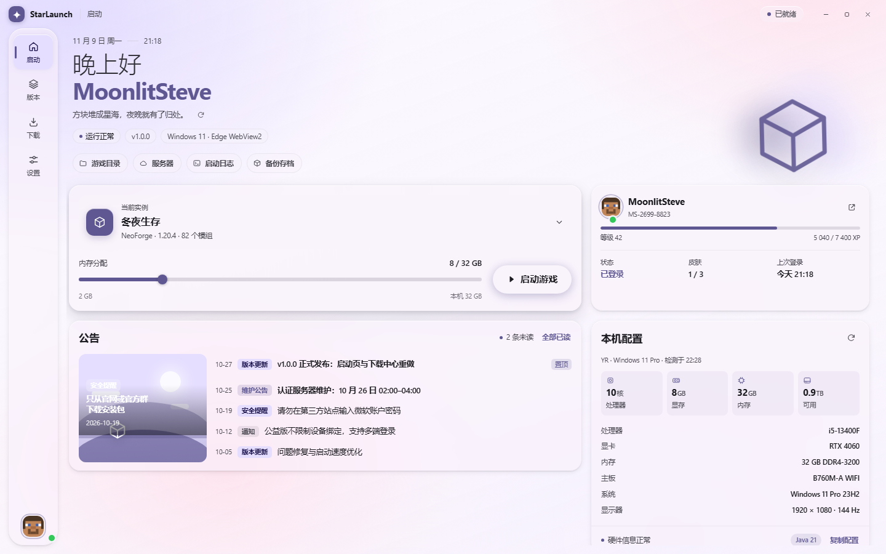
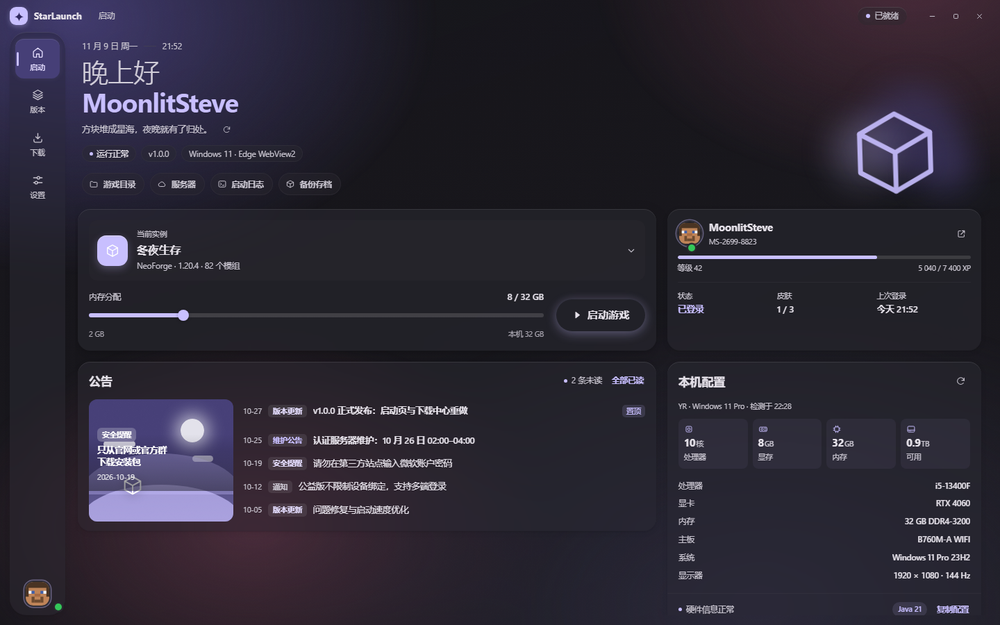
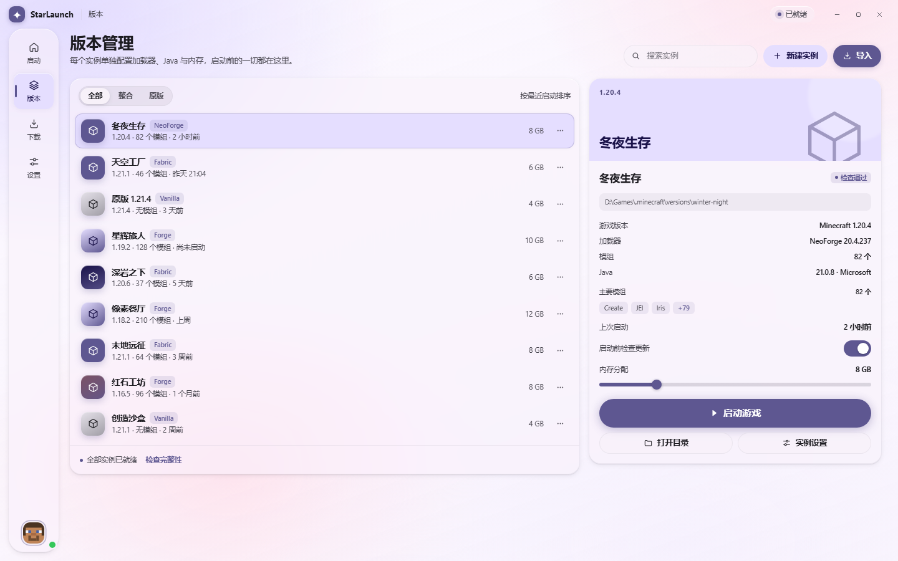
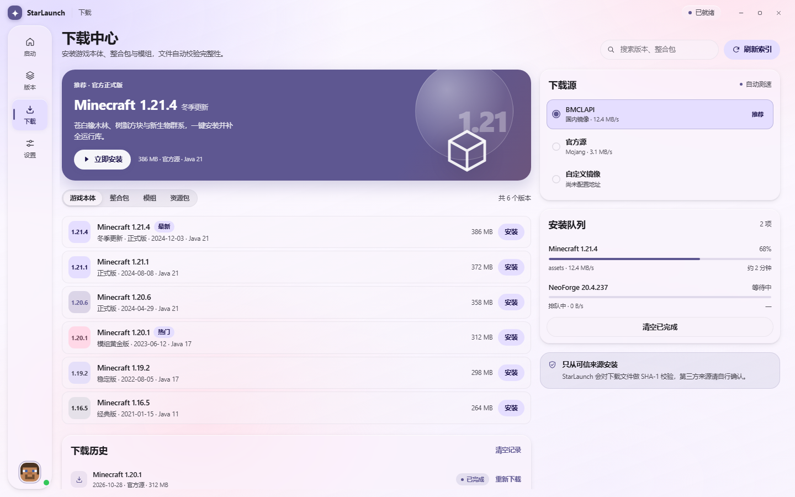
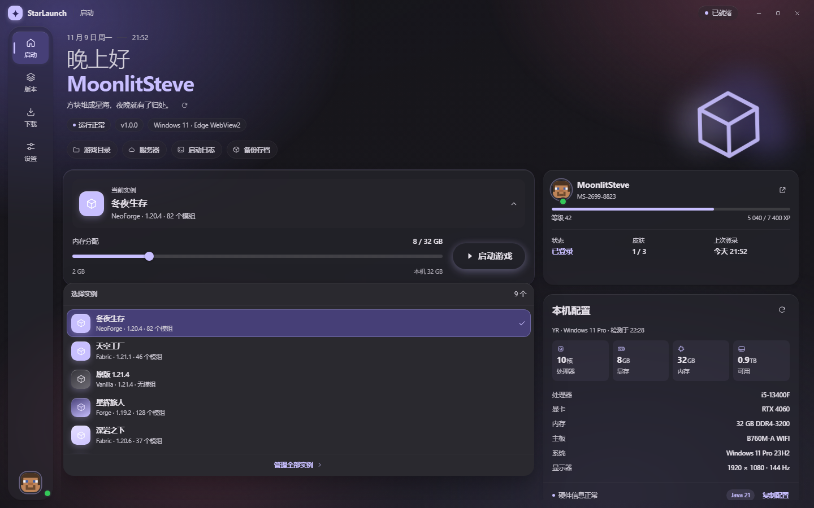
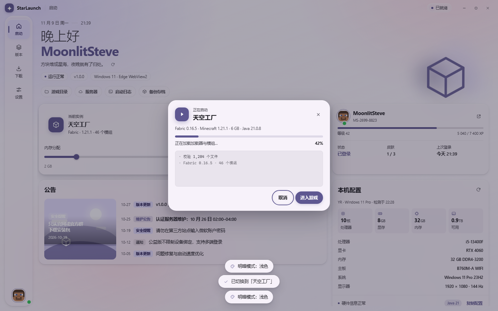
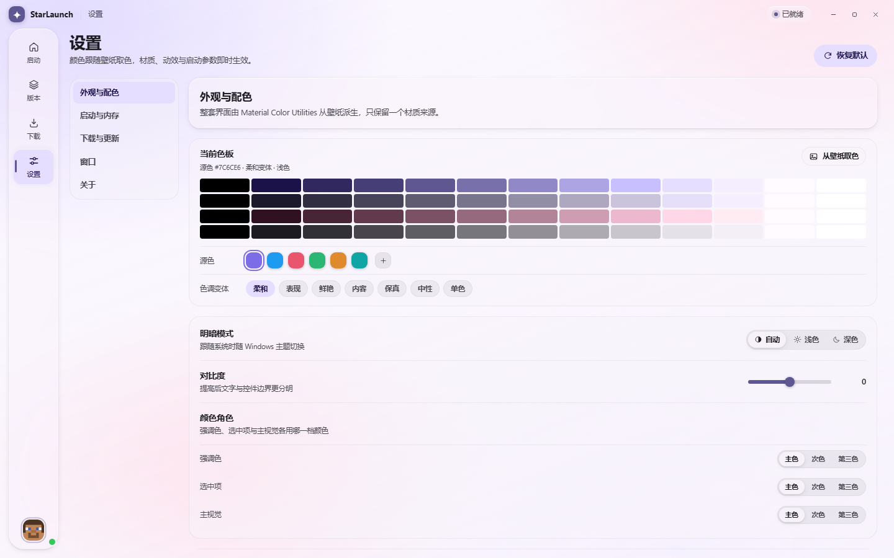
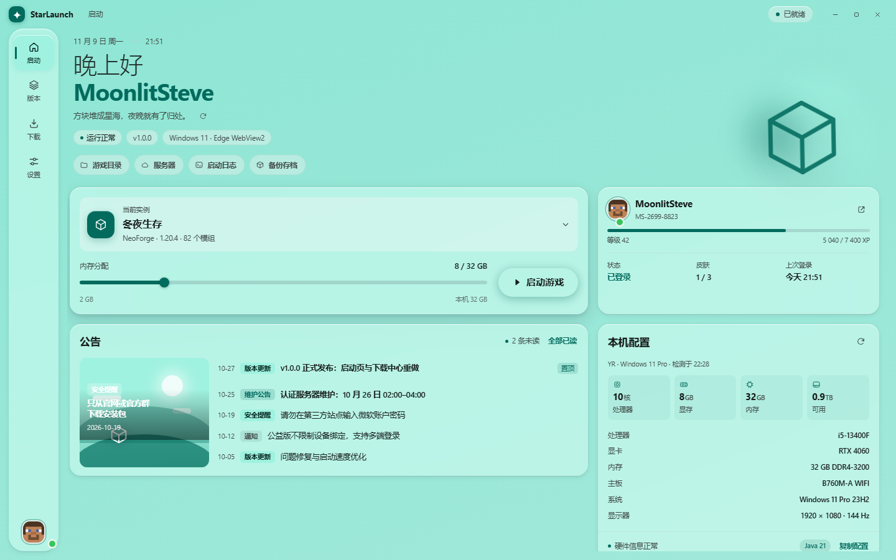
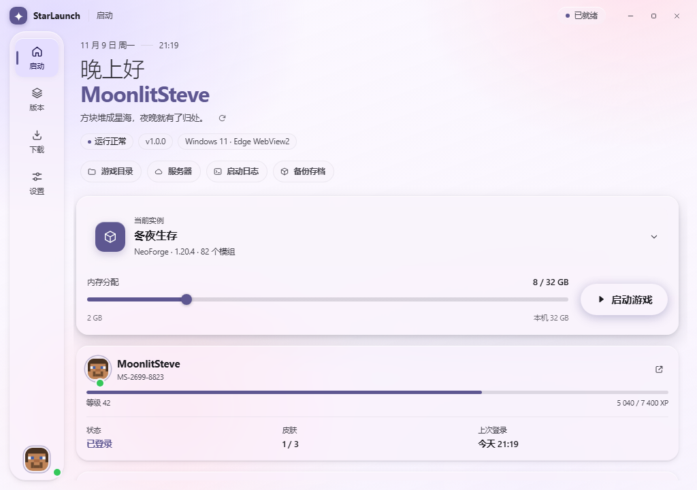

# StarLaunch

> 用 Web 技术写界面、用 WPF + WebView2 做外壳的 Minecraft 启动器。
> 整套 Material You 配色由 [Material Color Utilities](https://github.com/material-foundation/material-color-utilities)
> 在本地实时计算，界面完全离线，不依赖任何在线服务。



## 目录

- [一句话说清它是什么](#一句话说清它是什么)
- [已经能用的功能](#已经能用的功能)
- [还没接上的部分](#还没接上的部分)
- [界面预览](#界面预览)
- [技术栈](#技术栈)
- [快速开始](#快速开始)
- [整体架构](#整体架构)
- [版本与游戏文件夹](#版本与游戏文件夹)
- [整合包导入](#整合包导入)
- [自定义内容：Custom.xaml](#自定义内容customxaml)
- [公告与启动日志](#公告与启动日志)
- [Material You 配色](#material-you-配色)
- [宿主行为](#宿主行为)
- [数据与配置放在哪](#数据与配置放在哪)
- [开发约定与坑](#开发约定与坑)
- [调试](#调试)
- [当前限制](#当前限制)
- [许可证与致谢](#许可证与致谢)

## 一句话说清它是什么

启动器外壳只有一个无边框窗口和一块 WebView2，界面是 `WebAssets/` 里**零依赖**的
HTML + CSS + 原生 JavaScript。C# 只做三件事：把网页资源当成虚拟域名提供出去、
读写磁盘（扫描 `.minecraft`、解压整合包、读壁纸、读 `Custom.xaml`）、以及窗口相关操作。

所以改界面不需要编译 C#，改宿主能力也不需要动前端；两边的契约是
`https://app.local/` 下的几个 `GET` 接口和一组 `postMessage` 消息。

## 已经能用的功能

### 界面与配色

- 四个页面：启动、版本、下载、设置，全部离线可用，路由带方向感的滑动切换。
- **Material You 动态配色**：源色 → HCT → M3 Scheme → 35 个颜色角色 → CSS 变量，
  换源色 / 变体 / 明暗 / 对比度 / 颜色角色即时生效。
- 明暗模式可选「自动 / 浅色 / 深色」，自动模式跟随 Windows 主题。
- 材质滑杆（不透明度、模糊半径、泛光强度）加「性能模式」一键关掉模糊与背景动画。
- 启动页有时钟滚轮、问候语、内存条、实例浮层、公告栏与本周统计。

### 版本与游戏文件夹

- 宿主动态扫描 `.minecraft/versions`，**支持登记多个 `.minecraft`**（PCL 那种多文件夹），
  版本列表合并显示，每个文件夹各自记自己的版本隔离策略。
- 每个版本解析出加载器（Vanilla / Fabric / Forge / NeoForge / Quilt / OptiFine / LiteLoader）、
  原版版本号、模组数与模组名预览、目录体积、上次启动时间、JSON 损坏原因。
- 能识别「目录里有独立数据、但设置说不隔离」这种冲突状态（`mismatch`），在版本行上标出来。
- 选中文件夹可以单独设置隔离、打开目录、从列表移除（只取消登记，不动磁盘文件）。
- 导入整合包：`.zip` / `.mrpack` 解压后自动识别三种结构，落进当前文件夹。

### 自定义内容（PCL 的 Custom.xaml）

- 公告全部已读后，公告栏换成你自己写的内容，来源是启动器配置目录里的 `Custom.xaml`。
- 宿主用 `FileSystemWatcher` 盯着它，改完保存**自动刷新**，不用重启。
- 前端有一个 PCL 兼容的 XAML 渲染器，支持 `MyCard` / `MyHint` / `MyImage` / `MyButton` /
  `MyTextButton` / `MyIconTextButton` / `MyIconButton` / `MyListItem`、`TextBlock` 及其
  `Run` / `Bold` / `Hyperlink`、`StackPanel` / `Grid` / `Border` / `Path` / `Separator`。
- `EventType` + `EventData` 会真的执行：打开网页、弹出窗口、复制文本、打开文件 / 文件夹、
  下载文件、启动游戏、修改变量、刷新页面、打开帮助、内存优化、清理垃圾。
- 也支持「空白预设」（Markdown / XAML 直接写在设置里）和「本地文件」两种替代来源。

### 壁纸

- 壁纸放在独立目录，宿主扫描后通过 `/wallpapers/manifest.json` 提供清单。
- 设置页显示缩略图网格，支持随机 / 顺序轮播，间隔 1 / 5 / 10 / 30 分钟，切到后台暂停。
- 换图用双图层淡入（700 ms），不会白闪；也可以从当前壁纸取色，把主色变成新的主题源色。

### 启动器外壳

- 无边框自定义标题栏，`app-region: drag` 拖拽，最小化 / 最大化 / 关闭走 `postMessage`。
- 关掉了右键菜单、DevTools 和浏览器加速键，用起来更接近原生应用。
- 最小化时挂起 WebView2 渲染与计时器，恢复时唤醒；Win11 上开启系统圆角。
- 确认框是**网页自己画的浮层**（`SL.ui.dialog`），不是系统 MessageBox：
  危险操作默认焦点在「取消」，Esc / 点遮罩都算取消，关掉会把焦点还回原处。

### 交互细节

- 桌面界面默认禁止选中文字，只有输入框、日志、公告正文和代码块可选中。
- 页面切换时主要区块按 DOM 顺序以 32 ms 递增延迟浮入（单块 420 ms，最多叠 7 层延迟）；
  遵循 `prefers-reduced-motion`。
- 确认弹窗、Toast、浮层都复用同一套 `.modal` / `.popover` 材质。

## 还没接上的部分

这是「界面 + 宿主能力」都基本完工、但**启动核心还没接**的阶段：

- **启动游戏是模拟的**：进度条、日志、完成状态由前端定时器播放，没有真的拼命令行、
  没有 `Process.Start` 去拉起 Java。
- **下载中心是示例数据**：原版版本、Mod、整合包、资源包、光影包的列表和下载队列都来自
  `js/01-data.js` 的静态常量，不会真的联网下载。
- 账户 / 皮肤 / Java 自动检测 / 版本清单校验仍是界面占位。
- 设置里的「记住窗口尺寸」「关闭时最小化到托盘」「启动前检查更新」等开关目前只存偏好，
  没有对应的宿主实现。
- 窗口固定 1280×800（`ResizeMode="NoResize"`），没有做多显示器与自由缩放。
- 无自动更新、无代码签名、未做单实例限制。

## 界面预览

| 启动页（浅色） | 启动页（深色） |
| --- | --- |
|  |  |

| 版本页 | 下载页 |
| --- | --- |
|  |  |

| 实例选择 | 启动进度 |
| --- | --- |
|  |  |

| 设置页 | 壁纸取色 |
| --- | --- |
|  |  |

窄窗口（1024 px）下的布局：



## 技术栈

| 层 | 技术 |
| --- | --- |
| 外壳 | .NET 10 / WPF（`net10.0-windows`） |
| 浏览器控件 | Microsoft.Web.WebView2 `1.0.4314.35` |
| 界面 | HTML5 + CSS + 原生 JavaScript（无框架、无打包、无外部 CDN） |
| 配色 | Material Color Utilities `0.4.0`（Apache-2.0，经典脚本打包在 `WebAssets/mcu.js`） |
| 资源分发 | 全部编进程序集，由宿主经虚拟域名 `https://app.local/` 提供 |

## 快速开始

### 依赖

- Windows 10 1809 及以上（Win11 有系统圆角）
- [.NET 10 SDK](https://dotnet.microsoft.com/download)（要跑 `dotnet build` / `dotnet run`）
- Microsoft Edge WebView2 Runtime（Win11 一般自带；缺失时启动会弹出提示并退出）

### 构建与运行

```bash
# 项目根目录
dotnet run
```

或者用 Visual Studio 打开 `StarLaunch.slnx` 直接 F5。

宿主会把 `WebAssets/` 里的 HTML / CSS / JS 和 `assets/` 图片全部按目录通配嵌进程序集，
**新增前端文件不需要改 csproj**；但新增的 `<script>` / `<link>` 记得手动写进
`WebAssets/index.html`。

### 默认管理员权限

启动器**默认以管理员身份运行**：`app.manifest` 里写的是

```xml
<requestedExecutionLevel level="requireAdministrator" uiAccess="false" />
```

所以双击 exe（或在 VS 里 F5）都会先弹一次 UAC。要知道的几件事：

- **提权进程不能再驱动资源管理器**。打开文件夹走的是 `Services/ShellLaunch.cs` 里的
  `SHParseDisplayName` + `SHOpenFolderAndSelectItems`（和「在文件夹中显示」同一套 API），
  `explorer.exe` 那条最后手段在提权时会被跳过。万一还是打不开，网页浮层里会多出一个
  「以普通权限重启」的按钮。
- **WebView2 的内核永远跑在普通权限下**。在开了「管理员保护」（Administrator Protection）
  的内测版 Windows 上，提权后的用户和普通用户不是同一个，网页内核会因为读不到用户数据目录
  而初始化失败；`MainWindow` 遇到这种情况会问一句，然后以普通权限重启（降权实现见
  `Services/Elevation.cs`，用链接令牌 + `CreateProcessAsUser`）。
- 想改回普通权限：把 `app.manifest` 里那行换成 `level="asInvoker"`，重新生成即可。
  调试提权相关逻辑时记得两种身份各跑一遍。
- 排查时别被工具骗了：`dotnet run` 和 VS 的 F5 是 `CreateProcess` 直接拉 exe，不经过
  AppInfo，所以**不会弹 UAC，而是直接报错 740（请求的操作需要提升）**。想看真正的提权
  效果，要么双击 `bin/.../StarLaunch.exe`，要么让 Visual Studio 自己以管理员身份运行
  （右击 → 以管理员身份运行），要么在管理员权限的终端里 `dotnet run`。

### 打一个便携版

```bash
dotnet publish -c Release -r win-x64 --self-contained true
```

产物是一个文件夹（exe + 依赖 + 运行时），整个目录拷走就能用。
壁纸、配置、`Custom.xaml`、WebView2 缓存都落在 exe 同级；如果放在
`Program Files` 这种不可写的位置，会自动退到 `%LOCALAPPDATA%\StarLaunch`。

### 只想看界面

直接用浏览器打开 `WebAssets/index.html` 也能跑（`file://` 下特意没有用 ESM）。
此时没有宿主：

- 版本列表退回 `js/01-data.js` 里的示例数据；
- 壁纸库为空（拿不到 manifest），背景回退到氛围光；
- 下载、启动依然是模拟动画；
- 窗口按钮和文件选择走纯浏览器兜底。

## 整体架构

```
WPF 宿主进程（.NET 10）
├─ MainWindow.xaml / .xaml.cs   无边框窗口、WebView2 初始化、挂起 / 恢复、Win11 圆角
├─ Host/                        消息分发、虚拟域名资源服务、Custom.xaml、公告文件
├─ Api/                         /api/versions、/wallpapers/*、/api/local-image
└─ Services/                    配置持久化、扫描 .minecraft、整合包导入

        │  ① 导航到 https://app.local/index.html
        ▼
   WebView2（Chromium）
        │  ② GET /api/*、/wallpapers/*        ──▶ 宿主实时读盘后回内存流
        │  ③ postMessage 双向                 ──▶ 窗口控制 / 文件夹操作 / 内容推送
        ▼
   WebAssets（HTML + CSS + 原生 JS，全部编进程序集）
```

### 虚拟域名而不是 file://

启动后导航到 `https://app.local/index.html`。这个域名在磁盘上不存在，所有请求都在
`Host/WebResources.cs` 的 `OnWebResourceRequested` 里被拦下来：

| 请求路径 | 来源 |
| --- | --- |
| `/index.html`、`/js/*`、`/css/*`、`/assets/*` | 程序集嵌入资源 `StarLaunch.WebAssets.<路径，/ 换成 .>` |
| `/api/versions` | 实时扫描所有登记的 `.minecraft`（`Api/VersionsApi.cs`） |
| `/api/custom-home` | 读配置目录里的 `Custom.xaml`（`Host/CustomHome.cs`） |
| `/api/local-image?path=…` | 读本地图片，只放行图片扩展名、单文件 ≤ 16 MB（`Api/LocalFilesApi.cs`） |
| `/wallpapers/manifest.json` | 扫描壁纸目录生成清单（`Api/WallpapersApi.cs`） |
| `/wallpapers/<文件名>` | 读壁纸文件，只允许单层文件名，拒绝 `..` 与子目录 |

资源映射规则就是「路径里的 `/` 换成 `.`，加 `StarLaunch.WebAssets.` 前缀」，
找不到时返回 404，页面里能直接看到缺了哪个文件。嵌入资源和 `/api` 响应都带
`Cache-Control: no-store`，重新编译后不会读到缓存里的旧页面；壁纸文件例外，
URL 上挂了文件修改时间，单张按 1 小时缓存。

> 这是最容易踩的坑：浏览器里打开一切正常，编译后如果漏嵌了某个文件，宿主只会 404，
> 对应功能静默失效。`mcu.js` / `theme.js` 曾经就因为漏嵌，导致 exe 里配色引擎完全没启动。

### 三条通信通道

**1. 只读数据走 GET**（前端 `fetch`）：`/api/versions`、`/api/custom-home`、
`/api/local-image`、`/wallpapers/manifest.json`。

**2. 动作走 `postMessage`（网页 → 宿主）**，在 `Host/WebMessages.cs` 里分发：

| 类型 | 作用 |
| --- | --- |
| `add-game-dirs` | 多选添加 `.minecraft` 文件夹（旧名 `pick-game-dir` 仍兼容） |
| `remove-game-dir` | 从列表移除文件夹（内置目录不允许） |
| `set-dir-isolation` | 改某个文件夹的隔离策略（`all` / `modded` / `none`） |
| `set-active-dir` | 切换当前文件夹（导入整合包的目标） |
| `reset-game-dir` | 清掉自定义文件夹，回到只留内置 `.minecraft` |
| `open-game-dir` / `open-instance-dir` | 打开文件夹 / 打开版本目录（只允许已登记目录之内） |
| `import-modpack` | 选文件并导入整合包 |
| `open-wallpapers` | 打开壁纸目录 |
| `open-custom-home` / `open-custom-home-folder` / `reset-custom-home` | 编辑 / 打开所在目录 / 恢复默认模板 |
| `pick-notice-file` / `read-notice-file` | 选公告文件 / 重新读取已记住路径的文件 |
| `open-path` / `open-external` | 打开文件、文件夹或 http(s) 链接 |
| `window-control` | `minimize` / `maximize` / `close` |

**3. 状态回推 `postMessage`（宿主 → 网页）**：`game-dirs`、`modpack-import`、
`custom-home`、`notice-file`。前端按 `type` 分发，`custom-home` 推的是文件内容，
`game-dirs` 带回 `action` / `ok` / `error`，只有 `add` / `remove` / `isolation` / `reset`
会触发重新扫盘（`active` 只是侧栏状态，重扫会让切换文件夹变卡）。

窗口按钮另外有三级回退：`window.starLaunch.window.*`（可注入的原生 API）→
`postMessage({ type: 'window-control' })` → 自定义 DOM 事件（纯浏览器预览用）。

### 源码结构

C# 侧只有 16 个 `.cs` 文件，除了 `App.xaml.cs`、`AssemblyInfo.cs` 和 `Services/` 之外，
都是同一个 `MainWindow` 的 partial：

```
App.xaml / App.xaml.cs           WPF 入口
app.manifest                     清单：默认管理员（requireAdministrator）+ 高 DPI
MainWindow.xaml                  无边框窗口 + 一个 WebView2
MainWindow.xaml.cs               生命周期、WebView2 初始化、挂起 / 恢复、Win11 圆角
Host/WebMessages.cs              网页 → 宿主的消息分发
Host/WebResources.cs             虚拟域名资源服务与 /api 路由
Host/CustomHome.cs               Custom.xaml 的生成、监听与推送
Host/NoticeFiles.cs              公告文件的选择与读取
Api/VersionsApi.cs               /api/versions、游戏文件夹动作、整合包导入入口
Api/WallpapersApi.cs             壁纸目录扫描与 /wallpapers/*
Api/LocalFilesApi.cs             /api/local-image
Services/LauncherConfig.cs       配置持久化、游戏目录解析（GameDirs）
Services/MinecraftScanner.cs     扫 .minecraft/versions，算隔离与体积
Services/ModpackImporter.cs      整合包解压与结构识别
Services/CustomHome.cs           Custom.xaml 路径、模板与读写
Services/ShellLaunch.cs          打开文件 / 文件夹 / 链接（含提权时的回退顺序）
Services/Elevation.cs            提权判断 + 以普通权限重启（链接令牌）
```

前端每一块一个文件，按加载顺序：

```
js/00-core.js        工具函数、localStorage 读写、模块注册
js/01-data.js        静态数据（示例实例、下载目录、路由表、语录）
js/02-state.js       跨模块共享的偏好与当前实例
js/03-host.js        WebView2 桥接、窗口按钮、确认框入口
js/04-clock.js       主页时钟与问候
js/05-router.js      视图切换与切换动画
js/06-ui.js          Toast / 浮层 / 确认弹窗 / 快捷键
js/07-home.js        主页的实例选择与内存滑杆
js/08-versions.js    版本列表、详情、扫描结果
js/09-notice.js      公告、自定义内容、启动日志
js/10-launch.js      启动流程（目前是模拟）
js/11-download.js    下载中心（目前是示例数据）
js/12-appearance.js  外观：配色、材质、壁纸
js/13-settings.js    启动选项与设置页
js/14-folders.js     游戏文件夹列表（多 .minecraft）
js/15-events.js      全局点击委托
js/16-xaml-parse.js  Custom.xaml 解析（PCL 控件 → 节点树）
js/17-xaml-view.js   Custom.xaml 渲染、事件与变量
js/18-select.js      自绘下拉框（把 <select> 换成玻璃材质浮层）
app.js               引导：按顺序挂事件、渲染初始状态
```

样式在 `css/` 下按域拆成 16 个文件，`index.html` 里的顺序不能乱：
令牌 → 背景 → 外壳 → 舞台 → 组件 → 各页面（首页 / 版本 / 下载 / 设置）→ 浮层 → 杂项 →
XAML → 响应式。`WebAssets/style.css` 只剩一个空壳（旧路径兼容用，可以删）。

### 前端模块约定

不用 ESM、不用框架、不用打包，因为页面既要跑在 WebView2 里，也要能直接双击
`index.html`（`file://` 下 `import` 会被 CORS 拦掉，界面直接白屏）。每个文件是一个 IIFE：

```js
(function (global) {
    'use strict';

    const SL = global.SL;
    const { $, $$, escapeHtml } = SL.core;   // core / data / state 先加载，可以直接解构
    const uiMod = SL.core.mod('ui');         // 其它模块可能循环引用，用到时再取
    const toast = (...args) => uiMod.toast(...args);

    function doSomething() { /* ... */ }

    SL.versions = Object.assign(SL.versions || {}, { doSomething });
})(window);
```

`SL.core.mod(name)` 会先把空壳建出来、等对应文件加载完再填内容，所以 `ui ↔ launch ↔ router`
这种互相引用不会拿到 `undefined`。新增模块时在 `index.html` 里按依赖顺序加 `<script>`，
再在 `app.js` 的 `bind()` 里挂上事件即可。

## 版本与游戏文件夹

### 登记多个 `.minecraft`

配置存在 `StarLaunch.config.json` 的 `gameDirs` 数组里，每个文件夹有自己的隔离策略：

- 内置目录 = exe 同级的 `.minecraft`（没有就建出来），**永远排在第一个、不允许移除**；
- 添加时可多选；选到 `.minecraft` 的父目录会自动往下找一层，选到空文件夹就当作新游戏目录建起来；
- 同一个路径不会重复登记，路径比较不区分大小写；
- 老版本的单一 `gameDir` 字段会自动迁移成一个自定义文件夹。

### 扫描结果

`GET /api/versions` 每次都重新扫盘（往 `versions` 里丢个新版本，刷新页面就能看到），
返回 `folders`（文件夹摘要 + 统计）和 `versions`（合并后的版本列表）。每个版本里几个关键字段：

| 字段 | 含义 |
| --- | --- |
| `id` / `name` | `versions` 下的文件夹名 |
| `loader` / `loaderName` | Vanilla / Fabric / Forge / NeoForge / Quilt / OptiFine / LiteLoader |
| `mc` / `type` | 原版版本号 / `release`、`snapshot`、`old_beta`、`old_alpha` |
| `mods` / `modPreview` / `modsShared` | 模组数、前几个模组名、是否来自共享的根目录 |
| `isolated` / `isolatedByPolicy` / `mismatch` | 是否有独立数据 / 策略是否要求隔离 / 两者冲突 |
| `size` / `lastPlayed` / `error` | 目录体积、上次启动时间（`launcher_profiles.json` 优先）、损坏原因 |
| `dirId` / `dirPath` / `dirName` | 属于哪个 `.minecraft`（网页用它拼全局唯一 key） |

### 版本隔离

三档策略，逐文件夹设置：`all`（隔离所有版本）、`modded`（只隔离带模组的）、
`none`（全部共享根目录的 `mods` / `saves` / `config`）。扫描时会同时算「目录里实际有没有
独立数据」和「策略要不要隔离」，两者不一致就置 `mismatch`，版本行上会提示。

### 文件夹 ID

每个文件夹的 `id` 是路径的 FNV-1a 哈希（`GameDirs.MakeId`），格式 `d` + 8 位十六进制。
网页用 `dirId::版本名` 当合并列表里的唯一 key，所以这个值**必须稳定**：
哈希是对归一化并转小写后的 **UTF-16 字符**逐个异或计算的。
如果哪天改用其它语言重写这段（比如拿 UTF-8 字节去算），算出来的 id 会和已有配置、
网页里存的 key 全部对不上。

## 整合包导入

`Services/ModpackImporter.cs` 会把压缩包解到临时目录，再按结构分三种：

1. **带 `versions/` 的整包**（PCL 导出的 `.minecraft` 打包）→ 合并进当前游戏目录，
   已存在的版本目录不动；
2. **CurseForge**：`manifest.json` + `overrides/` → 落成 `versions/<整合包名>/` 独立实例；
3. **Modrinth**：`modrinth.index.json` + `overrides/` → 同上。

后两种会生成一个最小的版本 JSON（`id` + `inheritsFrom` + 加载器 libraries 坐标），
正好配合「隔离带模组的版本」：模组和配置都在版本目录里，不污染别的实例。

mrpack 里靠 URL 下载的模组文件**不会联网抓取**（宿主没有下载器），会如实写进返回的提示里。
导入结果通过 `modpack-import` 消息回推，成功就 toast 一句、失败给原因。

## 自定义内容：Custom.xaml

### 它是怎么被推送的

`Custom.xaml` 和 `StarLaunch.config.json` 放在同一个目录（exe 同级，不可写时退到
`%LOCALAPPDATA%\StarLaunch`），没有这个文件就自动写一份 `Resources/Custom.xaml` 模板。

- 页面导航完成后 `StartCustomHome()` 推一次内容；
- 网页启动时也会 `GET /api/custom-home` 拉一次，避免推送比页面先到；
- `FileSystemWatcher` 监听 `Changed` / `Created` / `Deleted` / `Renamed`（编辑器保存常常是
  「写临时文件 → 改名覆盖」），攒 260 ms 防抖后重读，再推 `custom-home`；
- 设置页可以「编辑文件 / 打开文件夹 / 恢复默认」。

### 支持的控件

```
容器  StackPanel（横 / 纵）、WrapPanel、Grid（ColumnDefinitions / RowDefinitions）、Border
基础  TextBlock（Run / Bold / Italic / Hyperlink / LineBreak）、Path、Separator
PCL   local:MyCard / MyHint / MyImage / MyButton / MyTextButton
      local:MyIconTextButton / MyIconButton / MyListItem
```

属性按 WPF 语义处理：`Margin` / `Padding`（左,上,右,下）、`Width` / `Height`、
`HorizontalAlignment` / `VerticalAlignment`、`FontSize` / `FontWeight` / `Foreground`、
`TextWrapping`、`Visibility`、`IsHitTestVisible`；颜色认 `#AARRGGBB`、颜色名和
`{DynamicResource ColorBrush1…8}`（用 `color-mix` 从主题色派生）。
`MyCard` 支持 `CanSwap` / `IsSwapped` 折叠，折叠用 `grid-template-rows: 1fr → 0fr` 做，
收起后给内容挂 `inert`，Tab 不会跳进看不见的地方。

### 事件与变量

`EventType` + `EventData` 目前实现了：打开网页、弹出窗口、复制文本、打开文件、打开文件夹、
下载文件、启动游戏、修改变量、刷新页面、打开帮助、内存优化、清理垃圾。
`local:CustomEventService.Events` 里的多个事件按顺序执行，`{variable:名字:默认值}`
用来在事件之间传状态。文本里还认 `[日期]` / `[时间]` 这类占位符。

### 本地图片

`MyImage` 的 `Source` 可以写网址、本地路径或相对路径。本地图片走
`GET /api/local-image?path=…` 由宿主读盘，只放行图片扩展名、单文件 ≤ 16 MB，
相对路径按 `Custom.xaml` 所在目录解析（和 PCL 一致）。PCL 内置的
`pack://application:,,,/images/…` 没有随包分发，会渲染成带名字的占位块。

### 两个坑

**命名空间里不能有空格。** PCL 默认写 `xmlns:local="clr-namespace:PCL;assembly=Plain Craft Launcher 2"`，
而 XML 规范要求命名空间是合法 URI，Chromium 会直接判整份文件不合法（面板上写着
「xmlns:local … is not a valid URI」）。解析前把 `clr-namespace:` 里的空格转义成 `%20` 就行——
渲染只按 `localName` 匹配，命名空间本身不参与。

**模板改完要重新编译。** `Resources/Custom.xaml` 是嵌入资源，并且必须在 csproj 里
`<Page Remove>` 掉：UseWPF 默认把 `**/*.xaml` 全当 Page 编译，里面的 `local:MyCard`
会直接编译失败。

## 公告与启动日志

- 公告列表目前是 `index.html` 里的静态示例（还没接后端），带未读状态：已读 ID 存在
  `starlaunch.notice.read.v1`，全部已读后固定显示自定义内容，设置里「重新显示公告」
  可以清掉已读状态。
- 自定义内容有三种来源：`Custom.xaml`（默认，改完自动刷新）、空白预设（Markdown 或 XAML
  直接写在设置里）、本地文件（`.md` / `.xaml` / `.xml` / `.txt`，≤ 2 MB）。本地文件的路径
  记在偏好里，下次启动通过 `read-notice-file` 让宿主重新读取，文件改了不用重新选。
- Markdown 走内置的轻量渲染器（标题、加粗、列表、引用、代码块），XAML 走上面那套
  PCL 兼容渲染器。
- 启动过程的日志会一行行写进 `starlaunch.launchlog.v1`，最多保留 300 行，
  显示在自定义内容下方，设置页有「清空日志」。

## Material You 配色

### 管线

```
源色 #7c6ce6
  └─ MCU.argbFromHex → MCU.Hct.fromInt            进入 HCT 色彩空间（色相 / 彩度 / 色调）
       └─ new SchemeTonalSpot(hct, isDark, contrast)
            └─ MCU.MaterialDynamicColors.<role>.getArgb(scheme)
                 └─ 35 个颜色角色 → --m3-* 与 --m3-*-rgb CSS 变量
```

`theme.js` 是唯一写颜色的地方，样式表里不出现硬编码色值，只消费 `--m3-*`、`--brand`、
`--glass-*`、`--text` 这些变量。换色时给 `<html>` 挂 380 ms 的 `.is-theming` 让元素自身
过渡，同时用 `CSS.registerProperty` 把关键颜色注册成 `<color>`，渐变里的 `var(--brand)`
也能逐帧插值；拖动取色滑杆走 silent 更新，不挂这个类，保持跟手。

### 7 种色调变体

| id | 界面名称 | MCU Scheme |
| --- | --- | --- |
| `tonalSpot` | 柔和 | `SchemeTonalSpot` |
| `expressive` | 表现 | `SchemeExpressive` |
| `vibrant` | 鲜艳 | `SchemeVibrant` |
| `content` | 内容 | `SchemeContent` |
| `fidelity` | 保真 | `SchemeFidelity` |
| `neutral` | 中性 | `SchemeNeutral` |
| `monochrome` | 单色 | `SchemeMonochrome` |

内置 6 个源色（琉璃紫 / 天青 / 樱粉 / 薄荷 / 暖橙 / 青碧），也可以从壁纸取色。
对比度滑杆对应 Scheme 构造函数的第三个参数（`-1` 到 `1`）。强调色、选中项、主视觉可以
分别指定用 `primary` / `secondary` / `tertiary`。

### 壁纸取色与轮播

壁纸目录：exe 同级的 `wallpapers\`（开发时是项目根目录的 `wallpapers\`），不可写时退回
`%LOCALAPPDATA%\StarLaunch\wallpapers`。宿主返回的清单形如
`{ folder, items: [{ name, url, size }] }`，`url` 带文件修改时间，图片换了 URL 也会变。

前端拿到清单后：先预加载目标图再切换 → 用 Canvas 读像素 →
`MCU.QuantizerCelebi.quantize(pixels, 64)` 量化成 64 色 → `MCU.Score.score(...)` 打分选出
源色（**不是平均色**，平均色会把鲜艳的图算成一坨灰）→ 结果按图片 URL 缓存。
换图只让上层淡入 700 ms，旧图全程不透明当底板，淡完再收掉——两层同时反向过渡会透出底色。

### 材质三规则

1. **唯一材质源**：玻璃层只用 `--glass-rgb` / `--glass-a` 派生出 `--glass` / `--glass-strong` /
   `--glass-weak`，不写死 `rgba()`，所以「材质不透明度」滑杆能同时作用于所有玻璃层。
2. **模糊只挂在最外层**：导航栏和浮层保留 `backdrop-filter`，大块面板改用更实的半透明底色，
   避免多个大面积图层同时合成导致卡顿；面板内部的列表行一律 `transparent`。
3. **浮层必须不透明**：菜单、对话框、Toast 用面层级容器。半透明菜单后面透出正文时，
   实测对比度仍有 1.14:1，看起来像没擦干净。

`css/13-misc.css` 里有一条 `html.is-theming *` 会把所有元素的 `transition-property` 换成颜色
属性（带 `!important`），所以背景层和卡片折叠各自写了权重更高的规则把过渡拨回来。
**往 `.is-theming` 里加全局过渡之前，先想一遍同时还有哪些动画在跑。**

### 性能

大块面板不用实时模糊、移除了全屏遮罩与噪点、滑杆输入合并到 `requestAnimationFrame`、
色板只在影响颜色的设置变化时重建、壁纸取色按 URL 缓存、切到后台暂停装饰动画与轮播。
设置里的「性能模式」一次性关掉模糊、泛光与背景动画，并改用不透明底色。

## 宿主行为

- 无边框窗口（`WindowStyle="None"` + `ResizeMode="NoResize"`，1280×800），
  靠 `IsNonClientRegionSupportEnabled` + CSS `app-region: drag` 实现标题栏拖拽。
- 关掉默认右键菜单、DevTools、浏览器加速键，并在 `AcceleratorKeyPressed` 里吃掉
  F12 / Ctrl+Shift+I/J/C/K/F / Ctrl+U；网页端 `keydown` 再兜一层。
- 最小化时 `TrySuspendAsync()` 暂停渲染与计时器，恢复时 `Resume()`；
  挂起途中窗口被恢复会立刻唤醒，避免白屏。
- WebView2 用户数据目录在 exe 同级 `WebView2Data`，不可写时退到
  `%LOCALAPPDATA%\StarLaunch\WebView2`。
- Win11 上用 `DwmSetWindowAttribute` 开启系统圆角，Win10 及更早保持默认形状。
- 初始化失败（缺 WebView2 Runtime、目录不可写）会弹出说明并退出，不会白屏。

## 数据与配置放在哪

### 磁盘

| 位置 | 内容 |
| --- | --- |
| exe 同级（不可写 → `%LOCALAPPDATA%\StarLaunch`） | `StarLaunch.config.json`、`Custom.xaml`、`WebView2Data\`、`wallpapers\` |

`StarLaunch.config.json` 大致长这样（字段是 camelCase，读盘时会做一次归一化，
手改坏了也会自动收敛回合法状态）：

```json
{
  "gameDirs": [
    { "id": "d1a2b3c4", "path": "D:\\Games\\.minecraft", "isolation": "all", "builtIn": true },
    { "id": "d5e6f7a8", "path": "E:\\MC\\1.20\\.minecraft", "name": "1.20 存档", "isolation": "modded" }
  ],
  "activeDir": "D:\\Games\\.minecraft",
  "isolation": "all"
}
```

`isolation` 只影响「之后新添加的文件夹」，每个文件夹自己的策略记在各自条目里。

### localStorage

| 键 | 内容 |
| --- | --- |
| `starlaunch.theme.v4` | 源色、变体、明暗、对比度、颜色角色、材质滑杆、壁纸轮播设置 |
| `starlaunch.ui.v3` | 当前实例、筛选、下载分类、设置页标签等界面状态 |
| `starlaunch.launch.v3` | 启动设置（内存、窗口、JVM 参数、高级选项……） |
| `starlaunch.notice.v1` | 自定义内容来源、预设文本、本地文件路径 |
| `starlaunch.notice.read.v1` | 已读公告 ID |
| `starlaunch.launchlog.v1` | 启动日志（最多 300 行） |

## 开发约定与坑

- **前端零构建**：不加打包、不加 CDN、不用 ESM；新文件写进 `index.html` 的 `<script>` /
  `<link>` 就行，`csproj` 靠通配自动嵌入。
- **C# 的隐式 using 只有 5 个**（`System`、`System.Collections.Generic`、`System.Linq`、
  `System.Threading`、`System.Threading.Tasks`）。用 `File` / `Path` / `Directory` 要自己写
  `using System.IO;`，用 `MessageBox` 要 `using System.Windows;`，否则会报「当前上下文中不存在」。
- **嵌入资源漏了就是 404**：新增图片、脚本、样式后，务必在 exe 里点一遍对应功能，
  浏览器预览正常不代表宿主正常。
- **`Resources/Custom.xaml` 要 `<Page Remove>`**，否则 WPF 会把它当页面编译并失败。
- **`mcu.js` 不要手改**：它是 Material Color Utilities 0.4.0 的经典脚本打包，头部写明由
  `tools/build-mcu.mjs` 从 jsDelivr 的官方 ESM 产物改写成挂 `window.MaterialColorUtilities`，
  并保留了 Apache-2.0 声明。当前工作区里只有产物、没有这个脚本，要升级版本就按头部说明
  重新导出，保持全局名不变。
- **深色模式别用属性选择器压配色**：写 `[data-mode="dark"] .x-btn { background: … }` 会盖掉
  `--accent` / `--red` / `--text`，正确做法是只覆盖 `--btn-bg` 之类的自定义属性。
- **图标 `<use>` 生成的 svg 必须带 `.icon` 类**，否则吃不到 `fill:none; stroke:currentColor`。
- **窗口相关的开关要和宿主对齐**：网页只存偏好，真正生效需要 `MainWindow` 那边实现。

## 调试

### 打开 DevTools

发布版默认把 DevTools 和加速键都关了。调试时把 `MainWindow.xaml.cs` 里的
`AreDevToolsEnabled`、`AreBrowserAcceleratorKeysEnabled` 改回 `true`，并在
`NavigationCompleted` 里调一次 `webView.CoreWebView2.OpenDevToolsWindow()`；
也可以用 `CoreWebView2EnvironmentOptions.AdditionalBrowserArguments` 传
`--remote-debugging-port=9222`，用外部 Chromium 连上去。

### 只跑前端

`WebAssets/` 是纯静态文件，起一个静态服务器就能调界面：

```bash
npx serve WebAssets
# 或：python -m http.server 8000 --directory WebAssets
```

想看到真实数据，需要在服务器上伪造 `/api/versions`、`/api/custom-home`、
`/wallpapers/manifest.json` 这三个响应，并用脚本桩一个 `window.chrome.webview`
（`postMessage` 收集消息、`addEventListener` 空实现）——这样整条前端代码路径都会走真实分支。

### 自动化验证

这个项目验证过的方式：jsdom 做 DOM 级冒烟（弹窗、焦点、消息），
真实 Chromium（Playwright / puppeteer-core，指定 `executablePath`）做截图和端到端点击，
静态服务器里造假接口、假宿主。改交互前先跑一遍这两层，比肉眼点更省事。

## 当前限制

见上文 [还没接上的部分](#还没接上的部分)，简单重复一遍最要紧的几条：
启动与下载都还是模拟，账户 / 皮肤 / Java 检测是占位，窗口尺寸固定，
托盘与自动更新未实现，发布物未签名。

## 许可证与致谢

- 本项目基于 [Apache License 2.0](LICENSE.txt) 发布。
- 配色库：[material-color-utilities](https://github.com/material-foundation/material-color-utilities)
  （Apache-2.0，Copyright 2021 Google LLC），`mcu.js` 头部保留原始版权声明。
- 视觉语言参考：[qqnt-liuli-theme](https://github.com/LilycleHeart/qqnt-liuli-theme) 的「琉璃」风格，
  并按 Material Design 3 规范重写。
- 图标为内联 SVG，字体使用系统字体（MiSans / HarmonyOS Sans SC / Segoe UI 回退），
  界面不依赖任何外部 CDN；品牌图在 `WebAssets/assets/`。

界面层的更细说明（材质规则、动画取舍、壁纸过渡为什么会被掐掉）见
[`WebAssets/README.md`](WebAssets/README.md)。
