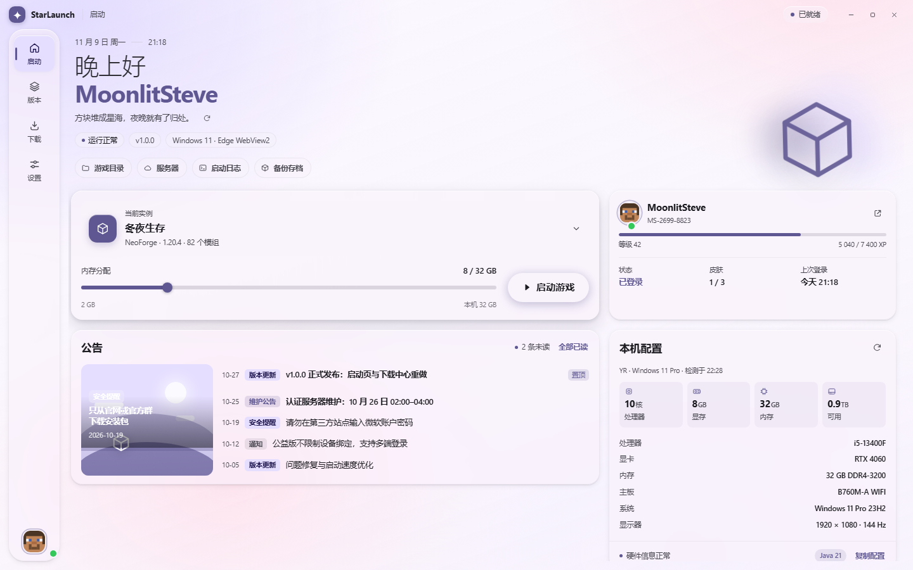
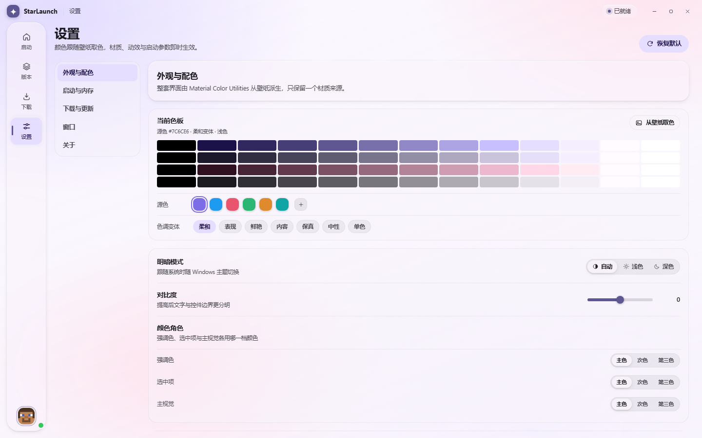
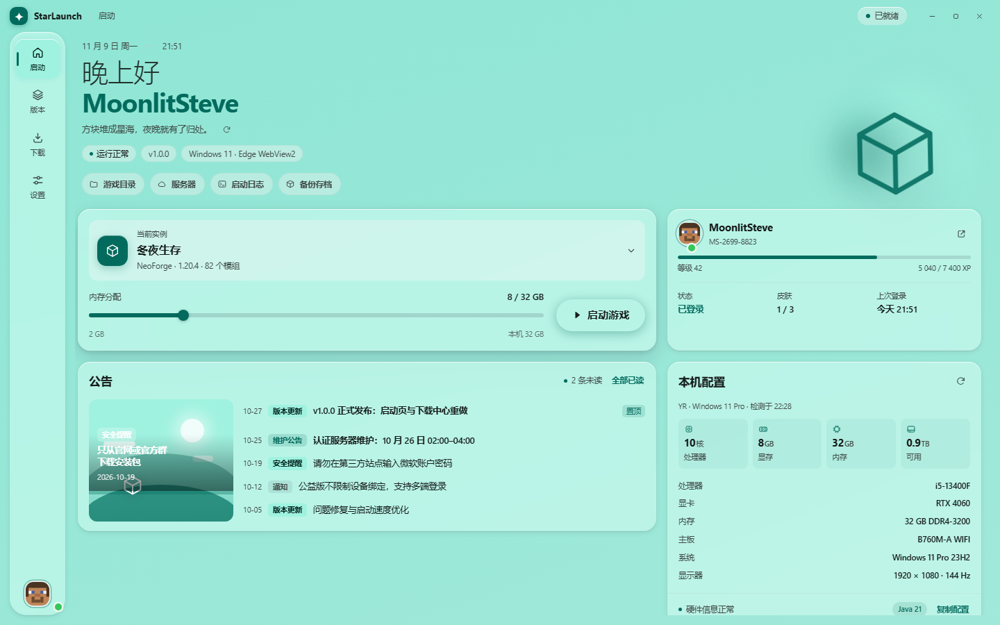
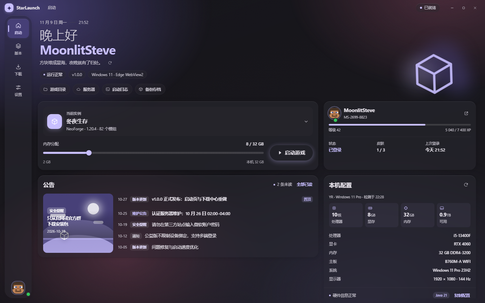
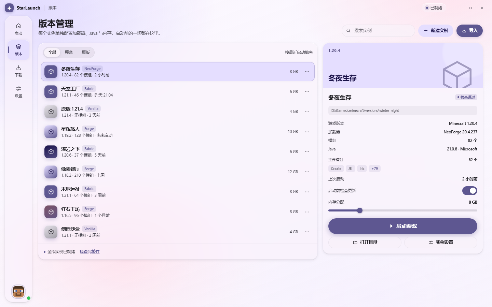
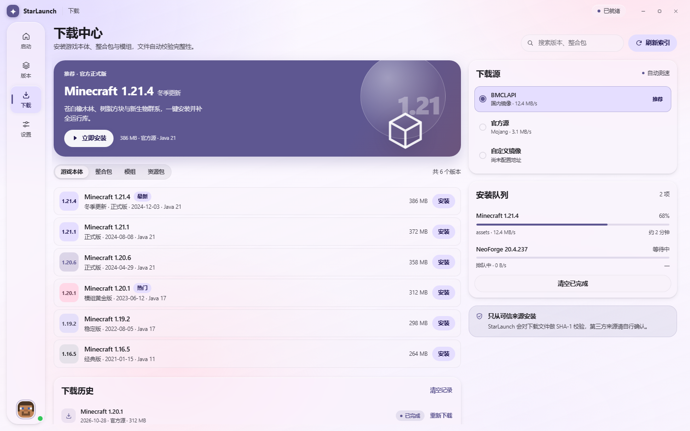
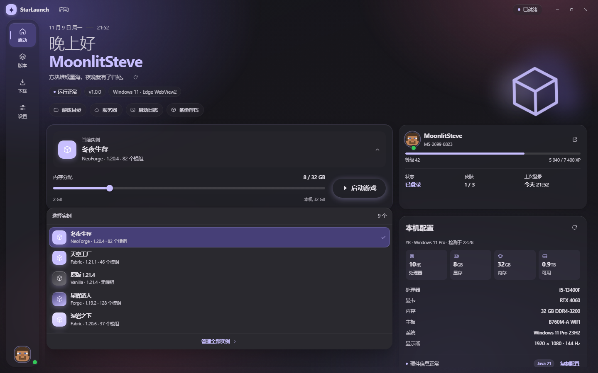
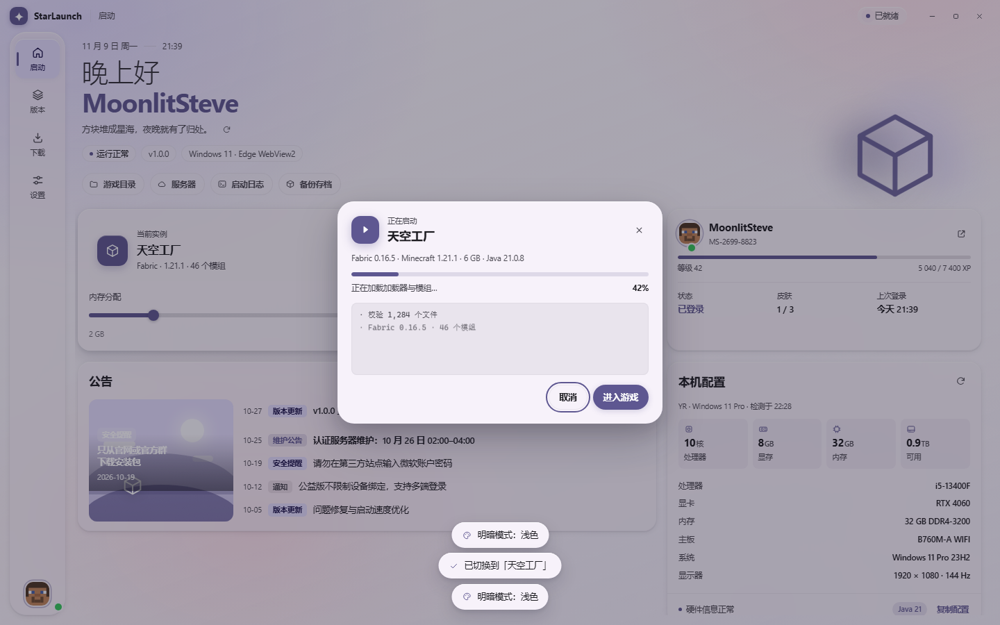

# StarLaunch · WebAssets

Minecraft 启动器（WebView2 宿主）的界面层。**Material You 动态配色**由
[Material Color Utilities](https://github.com/material-foundation/material-color-utilities)
在本地实时计算，材质语言参照 [qqnt-liuli-theme](https://github.com/LilycleHeart/qqnt-liuli-theme)
的「琉璃」风格重写。

包含启动 / 版本 / 下载 / 设置四个页面，全部离线可用。



## 文件

| 文件 | 说明 |
| --- | --- |
| `index.html` | 页面结构、内联 SVG 图标、四个视图 |
| `style.css` | 设计令牌、材质层、响应式布局（保留 `.custom-titlebar` 拖拽规则） |
| `theme.js` | 配色引擎：源色 → M3 色板 → CSS 变量，壁纸取色与遮罩推算 |
| `app.js` | 路由、时钟、实例切换、下载队列、设置项、启动进度 |
| `mcu.js` | Material Color Utilities 0.4.0 的经典脚本打包（勿手改，见下） |
| `tools/build-mcu.mjs` | 重新生成 `mcu.js` |
| `preview/` | 各页面实机截图 |

## 配色是怎么来的

打开页面时 `theme.js` 会做一次完整的 M3 派生：

```
源色 #7c6ce6
  → Hct.fromInt              换到 HCT 色彩空间（色相 / 彩度 / 色调）
  → SchemeTonalSpot(light|dark, contrast)
  → 56 个 MaterialDynamicColors 角色
  → 写入 --m3-* / --brand / --glass-* 等 CSS 变量
```

界面里所有颜色都读变量，`style.css` 中**没有任何硬编码色值**，
换源色 / 换变体 / 切明暗时不需要改样式表。

### 7 种色调变体

设置页可以切换 `tonalSpot`（柔和）、`expressive`（表现）、`vibrant`（鲜艳）、
`content`（内容）、`fidelity`（保真）、`neutral`（中性）、`monochrome`（单色），
都直接对应 MCU 的 `Scheme*` 实现。

### 三个颜色角色

强调色、选中项、主视觉可以各自指定用 `primary` / `secondary` / `tertiary`，
和参考主题的「颜色角色」设置同构。对比度滑杆对应 MCU 构造函数的第三个参数
（`-1` 到 `1`，M3 的对比度级别）。



## 从壁纸取色

「设置 → 外观与配色 → 选择图片」，或者直接把图片拖进窗口：

1. 图片先缩到最长边 1920px 并转 WebP，再写进 `localStorage`（避免 4K 原图常驻解码缓存）；
2. 用 MCU 的 `QuantizerCelebi` 把像素量化成 64 色，再用 `Score` 打分选源色
   —— **不是平均色**，平均色会把鲜艳的图算成一坨灰；
3. 同时估算壁纸平均亮度，据此推算一个「遮罩下限」。

第 3 步是为了可读性：玻璃是半透明的，壁纸太亮时深色文字会被冲掉。
用户手动设的遮罩低于这个下限时取下限，调高则尊重用户。



## 材质规则

从参考主题移植过来的三条硬规则，缺一条观感就会崩：

1. **唯一材质源**：所有玻璃层只用 `--glass` + `--glass-blur`，
   任何地方不写死 `rgba()` 数值。
2. **玻璃只挂在最外层**：导航、面板、卡片这些承载层才有 `backdrop-filter`；
   它内部的列表行、mini 卡片一律 `transparent`。
   否则 alpha 叠加，同一材质在嵌套处深浅不一（「玻璃叠玻璃」）。
3. **中间容器全部打透**，让壁纸和氛围光透出来。

例外是**浮层**（菜单、弹窗、toast）：它们必须不透明。
半透明菜单后面透出列表文字时，实测对比度仍有 1.14:1，logo 和标题会隐约浮在菜单上，
看起来像没擦干净。这里按 Material 3 规范处理 —— menu / dialog 用面层级容器，
只有承载层才是「有模糊的半透明」。

## 宿主桥接

标题栏继续沿用 `.custom-titlebar`（整条 `app-region: drag`，按钮 `no-drag`），
点最小化 / 最大化 / 关闭时按顺序尝试：

```js
window.starLaunch.window.minimize()                       // 1. 注入的宿主 API
window.chrome.webview.postMessage({ type: 'window-control', action })  // 2. WebView2
new CustomEvent('starlaunch:window-control', { detail: { action } })   // 3. DOM 事件
```

`MainWindow.xaml.cs` 已开启 `IsNonClientRegionSupportEnabled` 并监听
`webview-control` 消息，网页端不用改就能用。

## 关于 mcu.js

`mcu.js` 不是手写的，是 `tools/build-mcu.mjs` 从 jsDelivr 的 Rollup 产物改写的：

**为什么不用 `<script type="module">`**：WebView2 多数情况下以 `file://` 加载页面，
ESM 会被 CORS 拦下来，界面直接白屏。所以把它转成经典脚本，
挂在 `window.MaterialColorUtilities` 上。

需要升级版本时：

```bash
node tools/build-mcu.mjs
```

脚本会下载、改写尾部 `export {…}`、套一层 IIFE 并写出 `mcu.js`。
文件里保留了 Apache-2.0 许可头和来源地址。

## 性能

- 只有承载层带 `backdrop-filter`，按钮、chip、列表行这些碎元素不带；
- 「设置 → 性能模式」一次性关掉模糊、泛光和背景动画，并改用不透明底色；
- 窗口切到后台时 `.is-idle` 暂停所有装饰动画；
- 设置项全部走 `localStorage`，键名前缀 `starlaunch.`；
- 遵循 `prefers-reduced-motion`。

## 数据位置

- `app.js` 的 `INSTANCES`：主页实例浮层、版本列表、详情面板的唯一数据源；
- `app.js` 的 `DOWNLOADS`：下载中心全部分类；
- 外观设置 `starlaunch.theme.v3`，界面偏好 `starlaunch.ui.v3`，
  启动参数 `starlaunch.launch.v3`，壁纸 `starlaunch.wallpaper.v3`。

## 预览

| 浅色 | 深色 |
| --- | --- |
|  |  |

| 版本 | 下载 |
| --- | --- |
|  |  |




## 已知取舍

- 壁纸取色依赖 Canvas `getImageData`。极少数 WebView2 配置把 `file://`
  判成跨源，此时取色会失败并**静默保留当前源色**（控制台有一条 warn），
  壁纸本身仍然正常显示。
- 实例列表、下载数据目前是 `app.js` 里的静态数据，接宿主时替换成 IPC 拉取即可。
